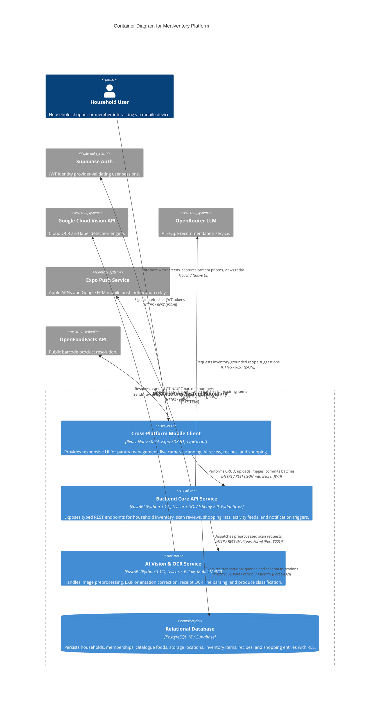

# C4 Level 2: Container Diagram (DOCS-05)

The **Containers** diagram zooms into the Mealventory system boundary, detailing the major executable services, mobile applications, data stores, inter-process communication protocols, and port allocations.

---

## 🗺️ Containers Diagram

---

## 📦 Container Specifications

### 1. Cross-Platform Mobile Client (`frontend`)
- **Technology Stack**: React Native 0.74, Expo SDK 51, TypeScript, Expo Router v3, TanStack Query v5.
- **State & Persistence**:
  - `SecureStore`: Encrypted storage for Supabase session JWTs.
  - `MMKV` / Memory Cache: High-performance caching for offline inventory queries.
- **Hardware Integration**:
  - `expo-camera` / `expo-barcode-scanner`: Hardware camera viewfinder with live barcode framing.
  - `expo-notifications`: Device push token registration and foreground banner handling.

### 2. Backend Core API Service (`backend`)
- **Technology Stack**: FastAPI, Uvicorn, Python 3.11, Pydantic v2, SQLAlchemy 2.0 Async, Alembic.
- **Runtime Environment**: Docker Container (`mealventory-backend:local`), Non-root user `appuser` (UID 10001), Port 8000.
- **Core Modules**:
  - `app.api.v1`: Routers for households, inventory, recipes, shopping, stores, activity, and notifications.
  - `app.services`: Business logic layer implementing duplicate item stacking, recipe deduction, and invite enrollments.
  - `app.core.security`: Cryptographic verification of Supabase JWTs with audience and role validation.

### 3. AI Computer Vision Service (`ai-services`)
- **Technology Stack**: FastAPI, Python 3.11, Pillow (PIL), TensorFlow / Keras MobileNetV2, Google Cloud Vision SDK.
- **Runtime Environment**: Docker Container (`mealventory-ai:local`), Non-root user `aiuser` (UID 10002), Port 8001.
- **Core Modules**:
  - `services.image_preprocessing`: EXIF transpose, RGB normalization, dynamic contrast/sharpness enhancement.
  - `services.ocr_service`: Layout analysis, line-item extraction, date regex parsing.
  - `utils.confidence_scoring`: Calibrated scoring, softmax margin penalties, `needs_review` evaluation.
  - `services.mock_engine`: Deterministic offline evaluation pipeline (< 50ms).

### 4. Relational Database (`database`)
- **Technology Stack**: PostgreSQL 16 (Hosted via Supabase or local Docker instance).
- **Security & Multi-Tenancy**:
  - Row-Level Security (RLS) policies on `inventory_items`, `households`, and `recipes` enforcing tenant isolation by `household_id`.
  - Scoped transaction rollbacks guaranteeing atomic multi-item batch saves.
