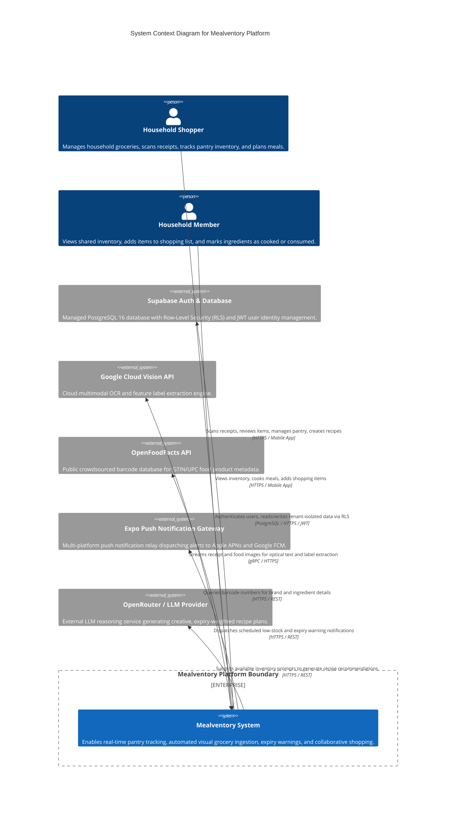

# C4 Level 1: System Context Diagram (DOCS-05)

The **System Context** diagram illustrates how Mealventory fits into the domestic grocery and household management ecosystem, highlighting primary actors, external system integrations, and core platform boundaries.

---

## 🗺️ System Context Diagram

---

## 👥 Primary Personas & Actors

| Actor | Role & Responsibilities | Key System Touchpoints |
|---|---|---|
| **Household Manager / Primary Shopper** | Owns the household tenant; scans bulk receipts after store trips; invites family members; establishes inventory storage locations. | Receipt Scanner, AI Review Sheet, Inventory CRUD, Household Settings. |
| **Household Member / Roommate** | Joined via invite code (`DEMO01`); marks items as consumed; checks pantry stock while at the supermarket; syncs shopping items. | Expiry Radar, Shopping List, Recipe Matcher, Cook Meal Deduction. |

---

## 🌐 External Dependencies & System Integrations

| External System | Integration Purpose | Protocol & Data Exchanged | Fallback / Resilience Strategy |
|---|---|---|---|
| **Supabase Auth & DB** | User registration, password resets, JWT authentication, and multi-tenant PostgreSQL storage with Row-Level Security. | HTTPS / REST / PostgreSQL wire protocol (Port 5432). JWT bearer tokens. | Local PostgreSQL with deterministic mock user IDs (`operations/demo-seeder-60.md`). |
| **Google Cloud Vision** | High-precision Optical Character Recognition (OCR) for paper receipts and expiry date tags. | HTTPS / Google Cloud SDK with Service Account credentials. | Deterministic offline mock engine (`MOCK_VISION=true`), MobileNetV2 local classification. |
| **OpenFoodFacts** | Real-time barcode (UPC/EAN) product metadata resolution. | HTTPS REST API (`https://world.openfoodfacts.org/api/v2/product/{barcode}.json`). | Manual product entry in mobile review sheet. |
| **Expo Push Service** | Background push notification delivery for imminent food spoilage alerts. | HTTPS REST API (`https://exp.host/--/api/v2/push/send`). | In-app visual Expiry Radar badges. |
| **OpenRouter LLM** | Generating culinary recipe ideas prioritizing pantry items expiring within 48 hours. | HTTPS REST API. JSON prompt with pantry list; returns structured ingredients. | Pre-seeded static recipe catalogue (10 recipes with ingredient mappings). |
