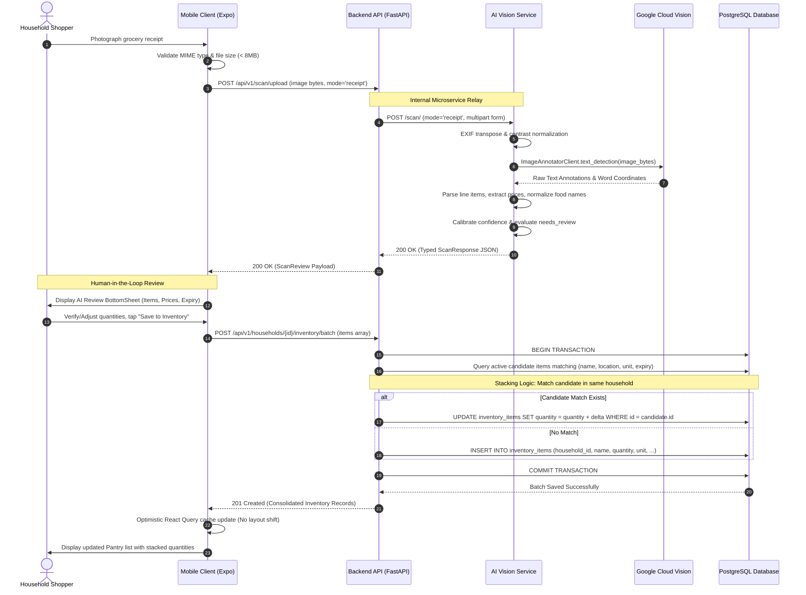
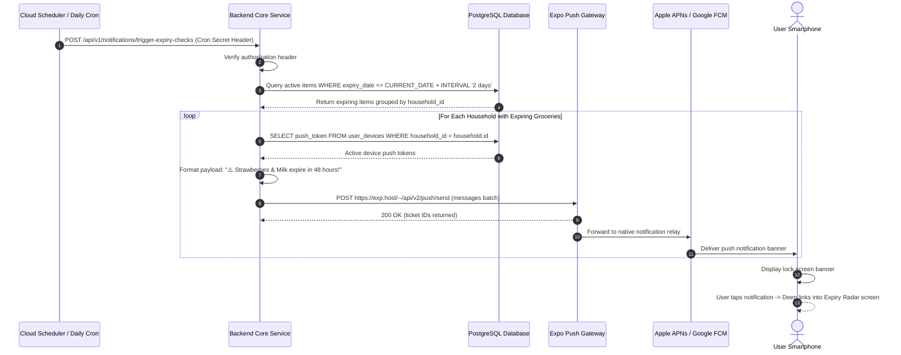
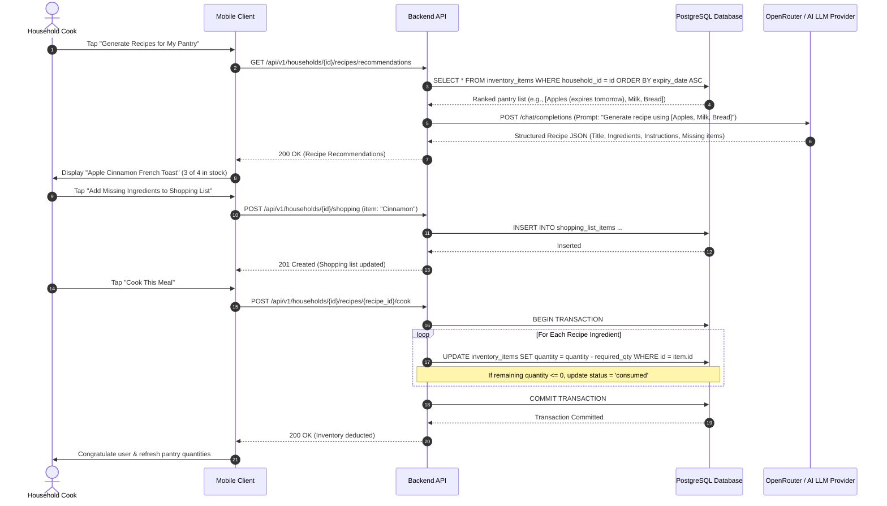

# End-to-End Data Flow Lifecycles & Sequence Diagrams (DOCS-05)

This document provides detailed sequence diagrams and technical lifecycles for Mealventory's core cross-service workflows:
1. **Multimodal Receipt Ingestion & Inventory Stacking**
2. **Daily Expiry Risk Evaluation & Push Notification Cron**
3. **Expiry-Weighted Recipe Recommendation & Cook Deduction**

---

## 🧾 1. Receipt Ingestion & Duplicate Item Stacking Flow

The receipt ingestion flow processes camera captures of paper grocery receipts, parses line items via OCR, presents an interactive human-in-the-loop review sheet, and stacks identical items in the pantry database without creating duplicates.

---

## 🔔 2. Daily Expiry Risk Evaluation & Push Notification Cron Flow

Mealventory scans household inventory daily to alert families before perishable groceries expire, reducing domestic waste.

---

## 🍳 3. Expiry-Weighted Recipe Recommendation & Cook Deduction Flow

Mealventory analyzes ingredients nearing expiration and prompts an LLM to design recipes that consume those items first. When cooked, the exact ingredient quantities are atomically deducted from the pantry.

