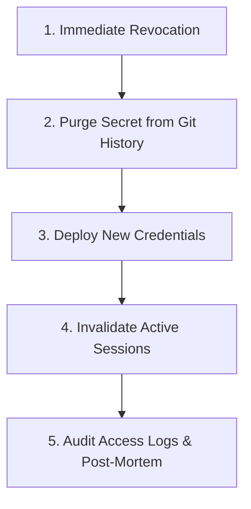

# Security Threat Model & Secrets Management Policy (DOCS-18)

This document establishes Mealventory's authoritative threat model, security trust boundaries, credential classification rules, and emergency secret leak incident procedures across `frontend`, `backend`, `ai-services`, and cloud infrastructure.

---

## 🛡️ 1. System Trust Boundaries & Threat Model

Mealventory partitions components into five explicit trust zones:

```text
[Zone 1: Public Untrusted]   --->  [Zone 2: Ingress & Tunnel]  --->  [Zone 3: Backend API Tier]
   - Expo Mobile Client                 - Cloudflare Tunnel                - FastAPI (Port 8000)
   - Mobile Camera Sensor               - TLS 1.3 Ingress                  - Non-root UID 10001
   - Local Device Storage                                                        |
                                                                                 v
[Zone 5: Data & Third-Party] <-------------------------------------  [Zone 4: Internal AI Mesh]
   - PostgreSQL 16 (RLS)                                                  - FastAPI Vision (Port 8001)
   - Supabase Auth                                                        - Non-root UID 10002
   - Google Cloud Vision                                                  - Pillow Sandbox
   - Expo Push Gateway
```

### Threat Analysis & Mitigation Matrix

| Threat ID | Threat Vector & Scenario | Impact | Technical Countermeasure | Verification |
|---|---|---|---|---|
| **THREAT-01** | **Cross-Tenant Access (IDOR)**<br>Attacker manipulates `household_id` in URL parameters to inspect or alter another family's pantry. | Severe (Privacy Breach) | **Database-enforced Row-Level Security (RLS)**.<br>PostgreSQL policies filter records strictly by `auth.uid() = household_members.user_id`. Backend queries execute in tenant context. | `tests/test_v1_consolidation.py`<br>`operations/demo-seeder-60.md` |
| **THREAT-02** | **Session Token Hijacking**<br>Attacker intercepts or extracts Supabase JWT from user's smartphone. | High (Account Takeover) | **SecureStore / Keychain Hardware Storage**.<br>Tokens are encrypted in native mobile keystores, never plain AsyncStorage. All communication uses HTTPS/TLS 1.3 with strict CORS origin verification. | `architecture/auth-session-persistence.md` |
| **THREAT-03** | **Invite Code Enumeration & Brute Force**<br>Attacker writes automated script to guess 6-character household codes (`DEMO01`). | Medium (Unauthorized Join) | **IP Rate Limiting & Constant-Time Matching**.<br>Backend enforces sliding-window rate limits on join endpoints ([operations/rate-limiting-88.md](rate-limiting-88.md)). | `tests/test_rate_limiting.py` |
| **THREAT-04** | **Malicious Image Uploads / Decompression Bombs**<br>Attacker uploads crafted 100MB TIFF or recursive ZIP bomb to crash vision service. | Medium (Denial of Service) | **Strict Ingress Preprocessing**.<br>File size capped at 8MB (`MAX_IMAGE_BYTES`). MIME types strictly whitelisted (`image/jpeg`, `image/png`, `image/webp`). Pillow limits max pixel allocation and decodes safely. | `tests/test_image_preprocessing.py`<br>`api/scan.py` |
| **THREAT-05** | **AI Service API Abuse & Cost Flooding**<br>Rogue bot floods receipt scan endpoint to exhaust Google Cloud Vision quotas. | Medium (Bill Shock) | **Scan Rate Limiting & Auth Gate**.<br>Scanning requires authenticated JWT. Per-household rate limits throttle concurrent uploads. Deterministic mock engine available for development. | `operations/rate-limiting-88.md` |
| **THREAT-06** | **Credential Leakage via Client Bundle**<br>Developer mistakenly exposes database credentials in mobile frontend environment. | Critical (Database Compromise) | **Prefix Isolation (`EXPO_PUBLIC_`)**.<br>Metro bundler strictly isolates variables. Only public non-sensitive configuration begins with `EXPO_PUBLIC_`. All database URLs, service roles, and private keys remain server-side. | Automated pre-commit linting & EAS secret injection. |

---

## 🔑 2. Credential Classification: Public vs. Server-Only

Every environment variable in Mealventory is classified into one of two security tiers:

### Tier 1: Public Client Configuration (Safe for Mobile Bundles)
These values are compiled into native mobile code and are visible to end users:

| Variable | Location | Purpose | Security Notes |
|---|---|---|---|
| `EXPO_PUBLIC_SUPABASE_URL` | `frontend/.env.local` | Supabase project API host | Public URL. Data access protected by Supabase RLS policies. |
| `EXPO_PUBLIC_SUPABASE_ANON_KEY` | `frontend/.env.local` | Public client anonymous key | Safe for client distribution. Does **NOT** grant administrative privileges. |
| `EXPO_PUBLIC_BACKEND_URL` | `frontend/.env.local` | Reverse proxy or tunnel URL | Points to backend API ingress. Contains zero secrets. |

### Tier 2: Server-Only Private Credentials (**NEVER** in Client)
These values must **NEVER** enter client source code, Expo environment files, or public git repos:

| Variable | Location | Owner | Security Function |
|---|---|---|---|
| `DATABASE_URL` | `backend/.env` | Backend Lead | PostgreSQL direct connection string with database password. |
| `SUPABASE_JWT_SECRET` | `backend/.env` | Security Lead | Cryptographic secret for signing and verifying user JWT sessions. |
| `SUPABASE_SERVICE_ROLE_KEY` | Secret Manager / CI | DevSecOps | Unrestricted admin key bypassing RLS. Used exclusively for administrative seeding or migration tasks. |
| `GOOGLE_APPLICATION_CREDENTIALS` | `ai-services/credentials/` | AI Lead | Google Cloud Vision IAM service account private key JSON. |
| `OPENROUTER_API_KEY` | `backend/.env` | Backend Lead | API token for recipe recommendation reasoning models. |
| `CRON_SECRET` | `backend/.env` | Backend Lead | Shared secret authenticating daily push notification cron jobs. |

---

## 🔄 3. Credential Rotation & Revocation Procedures

If a credential is leaked or periodic rotation is scheduled, follow the procedures below:

### 1. Rotating Supabase Database Password & JWT Secret
1. Open the **Supabase Dashboard** -> **Project Settings** -> **Database**.
2. Click **Reset Database Password**; generate a high-entropy 32-character string.
3. Update `DATABASE_URL` in backend secret managers (EAS / Docker runtime).
4. Restart backend processes: `alembic` connection pools immediately switch.
5. In **Project Settings** -> **API**, regenerate JWT Secret. Existing user sessions will be invalidated, prompting secure re-login.

### 2. Rotating Google Cloud Vision Service Account Key
1. Open the **GCP Console** -> **IAM & Admin** -> **Service Accounts**.
2. Select `mealventory-vision@project-id.iam.gserviceaccount.com`.
3. Under the **Keys** tab, click **Add Key** -> **Create new key (JSON)**.
4. Mount the new key in `ai-services` container: update `GOOGLE_APPLICATION_CREDENTIALS`.
5. Verify scan readiness: `GET http://localhost:8001/ready`.
6. Return to GCP Console and **Delete** the compromised old key ID.

### 3. Rotating Expo Push Notification Credentials
1. Run EAS credentials manager:
   ```bash
   eas credentials --platform ios
   eas credentials --platform android
   ```
2. Revoke and regenerate Apple Push Notification `.p8` key in Apple Developer Portal.
3. Upload new `.p8` key directly to EAS.

---

## 🚨 4. Emergency Secret Leak Incident Playbook

If a private credential is accidentally committed to Git:



### Step 1: Immediate Revocation (< 5 Minutes)
- **Do not wait to fix the code first**. Immediately log into the cloud provider (GCP, Supabase, Apple, OpenRouter) and **delete or disable the leaked key**. Once revoked, the leaked string is useless.

### Step 2: Purge Secret from Git History
- Simply committing a deletion in a new commit **does NOT remove the secret**; it remains in git history forever.
- Use `git-filter-repo` or BFG Repo-Cleaner to completely expunge the file from all past commits:
  ```bash
  git filter-repo --path credentials/leaked_key.json --invert-paths
  ```
- Force push updated branches: `git push origin --force --all`.

### Step 3: Issue New Credentials
- Generate fresh secrets following [Section 3](#-3-credential-rotation--revocation-procedures).
- Update CI secrets and environment files.

### Step 4: Audit Logs & Post-Mortem
- Check GCP Cloud Audit Logs and Supabase query logs for anomalous activity originating from unrecognized IPs during the exposure window.
- Document root cause in an incident report.

---

## ✅ 5. Pre-Release Security Checklist

Perform this audit prior to releasing mobile builds or merging backend pull requests:

- [ ] **No Hardcoded Secrets**: Ripgrep scan across all repos reveals zero unmasked private keys:
  ```bash
  git grep -E "(AIza[0-9A-Za-z-_]{35}|ghp_[0-9A-Za-z]{36}|postgres://.*:.*@)"
  ```
- [ ] **Prefix Compliance**: Only variables prefixed with `EXPO_PUBLIC_` exist in `frontend/.env.local`.
- [ ] **Row-Level Security Enabled**: All application tables in PostgreSQL have RLS enabled and tested.
- [ ] **Non-Root Containers**: Backend runs as UID `10001` (`appuser`); AI runs as UID `10002` (`aiuser`).
- [ ] **Rate Limiting Active**: Public auth join and scan routes enforce sliding-window rate limits.
- [ ] **HTTPS Enforced**: All mobile client traffic uses TLS 1.3 with validated host certificates.
